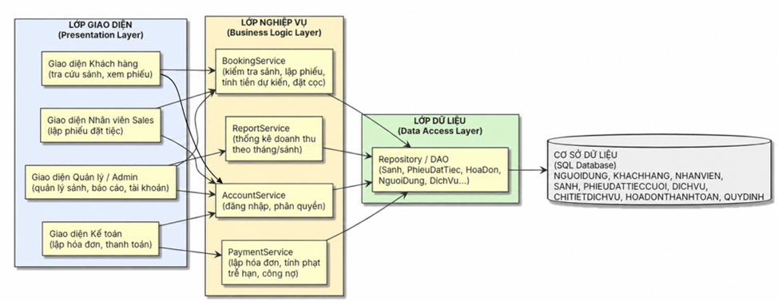

# Thiết kế kiến trúc — Hệ thống Quản lý Tiệc cưới

> Trích từ Báo cáo Lab 6 (Tuần 6: Architectural & Detailed Design), Chương 2.
> Nguồn: `Lab6_NhomBTB_52400170.docx`

## 1. Lựa chọn mô hình kiến trúc

Nhóm lựa chọn **kiến trúc 3 lớp (3-Tier Architecture)** vì ba lý do:

1. Hệ thống có nghiệp vụ rõ ràng, phân tách tốt giữa giao diện, xử lý nghiệp vụ và lưu trữ dữ liệu.
2. Dễ triển khai và dễ giải thích với một nhóm sinh viên 3 người trong thời gian học kỳ giới hạn.
3. Phù hợp với quy mô một hệ thống quản lý vừa và nhỏ (một trung tâm tiệc cưới), không cần đến độ phức tạp của kiến trúc Microservices.

## 2. Sơ đồ kiến trúc tổng thể

Luồng triển khai: **Lớp giao diện** gửi yêu cầu đến **Lớp nghiệp vụ**; Lớp nghiệp vụ sử dụng **Lớp dữ liệu** để truy xuất hoặc cập nhật cơ sở dữ liệu, sau đó trả kết quả ngược lại cho Lớp giao diện.

## 3. Trách nhiệm từng lớp

### 3.1. Lớp giao diện (Presentation Layer)

Dành cho 4 nhóm người dùng:

| Nhóm người dùng | Sử dụng                                       |
| --------------- | --------------------------------------------- |
| Khách hàng      | Tra cứu sảnh, xem phiếu                       |
| Nhân viên Sales | Lập phiếu đặt tiệc                            |
| Kế toán         | Lập hóa đơn, thanh toán                       |
| Quản lý / Admin | Quản lý sảnh, dịch vụ, tài khoản, xem báo cáo |

Lớp này chỉ hiển thị dữ liệu và thu thập thao tác người dùng, **không chứa logic nghiệp vụ**.

### 3.2. Lớp nghiệp vụ (Business Logic Layer)

| Service          | Trách nhiệm                                                                                                                                            |
| ---------------- | ------------------------------------------------------------------------------------------------------------------------------------------------------ |
| `BookingService` | Kiểm tra sảnh còn trống theo ngày/ca, kiểm tra số bàn và đơn giá theo QĐ1, lập phiếu đặt tiệc, tính tổng tiền dự kiến, kiểm tra tỉ lệ đặt cọc theo QĐ2 |
| `PaymentService` | Lập hóa đơn thanh toán, tính tiền phạt trễ hạn theo QĐ4, tính số tiền còn lại, cập nhật công nợ                                                        |
| `ReportService`  | Thống kê doanh số theo tháng và theo từng sảnh                                                                                                         |
| `AccountService` | Xác thực đăng nhập, phân quyền theo vai trò người dùng                                                                                                 |

### 3.3. Lớp dữ liệu (Data Access Layer)

Gồm các Repository/DAO (`Sanh`, `PhieuDatTiecCuoi`, `HoaDonThanhToan`, `NguoiDung`, `DichVu`, ...) thực hiện đọc, ghi và cập nhật dữ liệu xuống CSDL, cô lập các lớp phía trên khỏi chi tiết câu lệnh truy vấn.

### 3.4. Cơ sở dữ liệu

Lưu trữ toàn bộ dữ liệu: người dùng, khách hàng, nhân viên, sảnh, phiếu đặt tiệc cưới, dịch vụ, chi tiết dịch vụ, hóa đơn thanh toán và các quy định hệ thống (chi tiết tại [database-design.md](database-design.md)).

## 4. Luồng xử lý nghiệp vụ đặt tiệc cưới

Nhân viên Sales (giao diện) gửi yêu cầu lập phiếu đến `BookingService` → `BookingService` gọi Repository `Sanh` để kiểm tra sảnh còn trống theo ngày/ca → nếu còn trống và số bàn/đơn giá hợp lệ (QĐ1), `BookingService` tạo bản ghi `PhieuDatTiecCuoi` và `ChiTietDichVu` qua Repository tương ứng, tính tổng tiền dự kiến, kiểm tra tỉ lệ đặt cọc tối thiểu (QĐ2) → kết quả trả ngược về giao diện.

(Luồng này tương ứng Sequence Diagram "Lập phiếu đặt tiệc cưới" ở Tuần 5.)

## 5. Luồng xử lý thanh toán

Kế toán (giao diện) tìm phiếu đặt tiệc cần lập hóa đơn → `PaymentService` lấy thông tin phiếu qua Repository, kiểm tra ngày thanh toán so với ngày đãi tiệc; nếu trễ hạn, tính tiền phạt theo QĐ4 → `PaymentService` tính số tiền còn lại phải thu, tạo bản ghi `HoaDonThanhToan` qua Repository → kết quả (hóa đơn, số tiền còn lại) trả về giao diện Kế toán.

## 6. Lý do lựa chọn kiến trúc

1. Tách biệt rõ ràng giao diện – nghiệp vụ – dữ liệu, cho phép từng thành viên phát triển độc lập từng lớp theo Sprint (phù hợp quy trình Agile/Scrum đã áp dụng ở các tuần trước).
2. Dễ kiểm thử từng lớp riêng biệt (unit test cho `BookingService`/`PaymentService` mà không cần giao diện thật).
3. Dễ bảo trì và mở rộng — ví dụ khi bổ sung kênh giao diện mới (ứng dụng di động) chỉ cần thêm Lớp giao diện mới mà không thay đổi Lớp nghiệp vụ và dữ liệu.

## 7. Ánh xạ sang mã nguồn (Lab 7)

| Lớp kiến trúc (Lab 6)   | Thư mục mã nguồn                                                                                                |
| ----------------------- | --------------------------------------------------------------------------------------------------------------- |
| Lớp giao diện           | `frontend/src/pages`, `frontend/src/components`                                                                 |
| Tiếp nhận yêu cầu (API) | `backend/.../controller`, `backend/.../dto`                                                                     |
| Lớp nghiệp vụ           | `backend/.../service` (`AccountService`, `BookingService`, `PaymentService`, `ReportService`, `QuyDinhService`) |
| Lớp dữ liệu             | `backend/.../repository`, `backend/.../model`                                                                   |
| Cơ sở dữ liệu           | `database/schema.sql`, `database/seed.sql`                                                                      |
