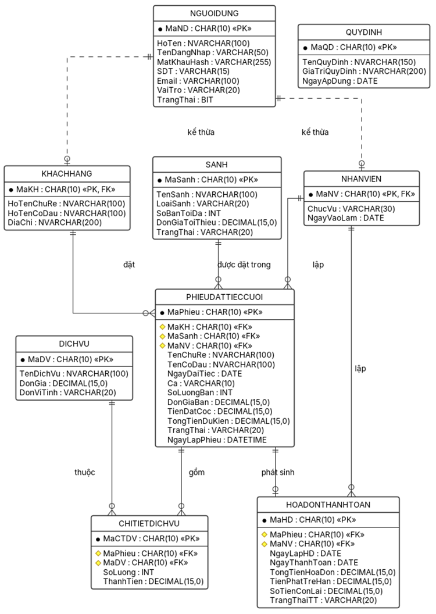
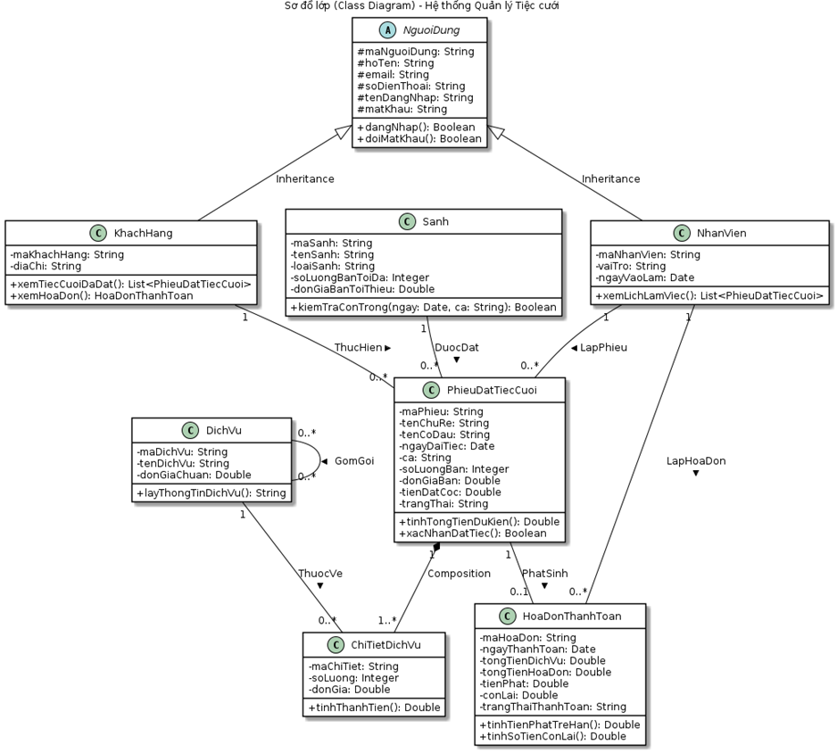

# Thiết kế cơ sở dữ liệu — Hệ thống Quản lý Tiệc cưới

> Trích từ Báo cáo Lab 6 (Tuần 6: Architectural & Detailed Design), Chương 3.
> Nguồn: `Lab6_NhomBTB_52400170.docx`

## 1. Danh sách thực thể

Từ Class Diagram ở Tuần 5, nhóm xác định **9 thực thể (bảng)**:

| Bảng               | Chức năng                                                                  |
| ------------------ | -------------------------------------------------------------------------- |
| `NGUOIDUNG`        | Lưu thông tin đăng nhập chung cho mọi loại người dùng                      |
| `KHACHHANG`        | Lưu thông tin chú rể/cô dâu (mở rộng từ `NGUOIDUNG`)                       |
| `NHANVIEN`         | Lưu thông tin nhân viên — Sales, Kế toán, Quản lý (mở rộng từ `NGUOIDUNG`) |
| `SANH`             | Lưu danh mục sảnh tiệc và đơn giá tối thiểu theo loại sảnh                 |
| `PHIEUDATTIECCUOI` | Lưu thông tin phiếu đặt tiệc cưới của khách hàng                           |
| `DICHVU`           | Lưu danh mục dịch vụ / món ăn phát sinh                                    |
| `CHITIETDICHVU`    | Lưu chi tiết dịch vụ được chọn cho từng phiếu đặt tiệc                     |
| `HOADONTHANHTOAN`  | Lưu hóa đơn thanh toán phát sinh sau khi tiệc kết thúc                     |
| `QUYDINH`          | Lưu các quy định hệ thống có thể thay đổi (QĐ1, QĐ2, QĐ4, QĐ6)             |

## 2. Sơ đồ ERD

## 3. Mô tả các bảng

- `NGUOIDUNG` là bảng cha chung, lưu thông tin đăng nhập (tài khoản, mật khẩu hash, vai trò); `KHACHHANG` và `NHANVIEN` là bảng con, dùng chung khóa chính với `NGUOIDUNG` (kiểu kế thừa bảng con).
- `SANH` độc lập với các bảng khác, được tham chiếu bởi `PHIEUDATTIECCUOI` mỗi khi lập phiếu.
- `PHIEUDATTIECCUOI` là bảng trung tâm, tham chiếu đến `KHACHHANG`, `SANH` và `NHANVIEN` (người lập phiếu); là bảng cha của `CHITIETDICHVU` và `HOADONTHANHTOAN`.
- `CHITIETDICHVU` là bảng trung gian N–N giữa `PHIEUDATTIECCUOI` và `DICHVU`, lưu số lượng và thành tiền của từng dịch vụ trong một phiếu.
- `HOADONTHANHTOAN` phát sinh từ một `PHIEUDATTIECCUOI`, do một `NHANVIEN` (Kế toán) lập.
- `QUYDINH` lưu các quy định có thể thay đổi, tách riêng khỏi logic nghiệp vụ để Quản lý nhà hàng có thể cập nhật mà không cần sửa mã nguồn (hỗ trợ QĐ6).

## 4. Data Dictionary

### 4.1. Bảng NGUOIDUNG

| Thuộc tính  | Kiểu dữ liệu  | PK/FK | Ràng buộc                | Ý nghĩa                           |
| ----------- | ------------- | ----- | ------------------------ | --------------------------------- |
| MaND        | CHAR(10)      | PK    | NOT NULL                 | Mã người dùng, khóa chính         |
| HoTen       | NVARCHAR(100) | —     | NOT NULL                 | Họ và tên người dùng              |
| TenDangNhap | VARCHAR(50)   | —     | UNIQUE, NOT NULL         | Tên đăng nhập hệ thống            |
| MatKhauHash | VARCHAR(255)  | —     | NOT NULL                 | Mật khẩu đã mã hóa (hash)         |
| SDT         | VARCHAR(15)   | —     | NULL                     | Số điện thoại liên hệ             |
| Email       | VARCHAR(100)  | —     | NULL                     | Địa chỉ email                     |
| VaiTro      | VARCHAR(20)   | —     | NOT NULL, CHECK IN (...) | Vai trò: KhachHang/NhanVien/Admin |
| TrangThai   | BIT           | —     | DEFAULT 1                | 1 = đang hoạt động, 0 = bị khóa   |

### 4.2. Bảng KHACHHANG

| Thuộc tính | Kiểu dữ liệu  | PK/FK  | Ràng buộc           | Ý nghĩa                                      |
| ---------- | ------------- | ------ | ------------------- | -------------------------------------------- |
| MaKH       | CHAR(10)      | PK, FK | FK → NGUOIDUNG.MaND | Mã khách hàng, dùng chung khóa với NGUOIDUNG |
| HoTenChuRe | NVARCHAR(100) | —      | NOT NULL            | Họ tên chú rể                                |
| HoTenCoDau | NVARCHAR(100) | —      | NOT NULL            | Họ tên cô dâu                                |
| DiaChi     | NVARCHAR(200) | —      | NULL                | Địa chỉ liên hệ                              |

### 4.3. Bảng NHANVIEN

| Thuộc tính | Kiểu dữ liệu | PK/FK  | Ràng buộc           | Ý nghĩa                                     |
| ---------- | ------------ | ------ | ------------------- | ------------------------------------------- |
| MaNV       | CHAR(10)     | PK, FK | FK → NGUOIDUNG.MaND | Mã nhân viên, dùng chung khóa với NGUOIDUNG |
| ChucVu     | VARCHAR(30)  | —      | NOT NULL            | Sales / Kế toán / Quản lý                   |
| NgayVaoLam | DATE         | —      | NOT NULL            | Ngày bắt đầu làm việc                       |

### 4.4. Bảng SANH

| Thuộc tính     | Kiểu dữ liệu  | PK/FK | Ràng buộc                 | Ý nghĩa                                        |
| -------------- | ------------- | ----- | ------------------------- | ---------------------------------------------- |
| MaSanh         | CHAR(10)      | PK    | NOT NULL                  | Mã sảnh, khóa chính                            |
| TenSanh        | NVARCHAR(100) | —     | UNIQUE, NOT NULL          | Tên sảnh                                       |
| LoaiSanh       | VARCHAR(20)   | —     | NOT NULL, CHECK IN (A..E) | Loại sảnh — quyết định đơn giá tối thiểu (QĐ1) |
| SoBanToiDa     | INT           | —     | NOT NULL, CHECK > 0       | Số bàn tối đa của sảnh                         |
| DonGiaToiThieu | DECIMAL(15,0) | —     | NOT NULL, CHECK >= 0      | Đơn giá tối thiểu theo loại sảnh (QĐ1)         |
| TrangThai      | VARCHAR(20)   | —     | DEFAULT 'Hoạt động'       | Trạng thái hoạt động của sảnh                  |

### 4.5. Bảng PHIEUDATTIECCUOI

| Thuộc tính     | Kiểu dữ liệu  | PK/FK | Ràng buộc                       | Ý nghĩa                                  |
| -------------- | ------------- | ----- | ------------------------------- | ---------------------------------------- |
| MaPhieu        | CHAR(10)      | PK    | NOT NULL                        | Mã phiếu đặt tiệc, khóa chính            |
| MaKH           | CHAR(10)      | FK    | FK → KHACHHANG.MaKH             | Khách hàng đặt tiệc                      |
| MaSanh         | CHAR(10)      | FK    | FK → SANH.MaSanh                | Sảnh được đặt                            |
| MaNV           | CHAR(10)      | FK    | FK → NHANVIEN.MaNV              | Nhân viên Sales lập phiếu                |
| TenChuRe       | NVARCHAR(100) | —     | NOT NULL                        | Tên chú rể (snapshot tại thời điểm đặt)  |
| TenCoDau       | NVARCHAR(100) | —     | NOT NULL                        | Tên cô dâu                               |
| NgayDaiTiec    | DATE          | —     | NOT NULL                        | Ngày tổ chức tiệc cưới                   |
| Ca             | VARCHAR(10)   | —     | CHECK IN (Sáng,Trưa,Tối)        | Ca tiệc                                  |
| SoLuongBan     | INT           | —     | CHECK <= Sanh.SoBanToiDa        | Số bàn đặt                               |
| DonGiaBan      | DECIMAL(15,0) | —     | CHECK >= Sanh.DonGiaToiThieu    | Đơn giá mỗi bàn (QĐ1)                    |
| TienDatCoc     | DECIMAL(15,0) | —     | CHECK >= 30% TongTien (QĐ2)     | Số tiền khách đã đặt cọc                 |
| TongTienDuKien | DECIMAL(15,0) | —     | NOT NULL                        | Tổng tiền dự kiến (bàn + dịch vụ)        |
| TrangThai      | VARCHAR(20)   | —     | DEFAULT 'Tạm giữ'               | Tạm giữ / Đã đặt cọc / Đã hủy / Hoàn tất |
| NgayLapPhieu   | DATETIME      | —     | DEFAULT NOW()                   | Thời điểm lập phiếu                      |
| —              | —             | —     | UNIQUE(MaSanh, NgayDaiTiec, Ca) | Chống đặt trùng sảnh/ngày/ca             |

### 4.6. Bảng DICHVU

| Thuộc tính | Kiểu dữ liệu  | PK/FK | Ràng buộc            | Ý nghĩa                         |
| ---------- | ------------- | ----- | -------------------- | ------------------------------- |
| MaDV       | CHAR(10)      | PK    | NOT NULL             | Mã dịch vụ, khóa chính          |
| TenDichVu  | NVARCHAR(100) | —     | UNIQUE, NOT NULL     | Tên dịch vụ/món ăn              |
| DonGia     | DECIMAL(15,0) | —     | NOT NULL, CHECK >= 0 | Đơn giá dịch vụ                 |
| DonViTinh  | VARCHAR(20)   | —     | NOT NULL             | Đơn vị tính (bàn, phần, giờ...) |

### 4.7. Bảng CHITIETDICHVU

| Thuộc tính | Kiểu dữ liệu  | PK/FK | Ràng buộc                     | Ý nghĩa                                  |
| ---------- | ------------- | ----- | ----------------------------- | ---------------------------------------- |
| MaCTDV     | CHAR(10)      | PK    | NOT NULL                      | Mã chi tiết dịch vụ, khóa chính          |
| MaPhieu    | CHAR(10)      | FK    | FK → PHIEUDATTIECCUOI.MaPhieu | Phiếu đặt tiệc liên quan                 |
| MaDV       | CHAR(10)      | FK    | FK → DICHVU.MaDV              | Dịch vụ được chọn                        |
| SoLuong    | INT           | —     | CHECK > 0                     | Số lượng sử dụng                         |
| ThanhTien  | DECIMAL(15,0) | —     | = SoLuong × DonGia            | Thành tiền của dòng dịch vụ              |
| —          | —             | —     | UNIQUE(MaPhieu, MaDV)         | Một dịch vụ chỉ một dòng trong một phiếu |

### 4.8. Bảng HOADONTHANHTOAN

| Thuộc tính     | Kiểu dữ liệu  | PK/FK | Ràng buộc                             | Ý nghĩa                                     |
| -------------- | ------------- | ----- | ------------------------------------- | ------------------------------------------- |
| MaHD           | CHAR(10)      | PK    | NOT NULL                              | Mã hóa đơn, khóa chính                      |
| MaPhieu        | CHAR(10)      | FK    | UNIQUE, FK → PHIEUDATTIECCUOI.MaPhieu | Phiếu được thanh toán (1–0..1)              |
| MaNV           | CHAR(10)      | FK    | FK → NHANVIEN.MaNV                    | Kế toán lập hóa đơn                         |
| NgayLapHD      | DATE          | —     | NOT NULL                              | Ngày lập hóa đơn                            |
| NgayThanhToan  | DATE          | —     | NOT NULL                              | Ngày khách thanh toán                       |
| TongTienHoaDon | DECIMAL(15,0) | —     | NOT NULL                              | Tổng tiền thực tế (bàn + dịch vụ phát sinh) |
| TienPhatTreHan | DECIMAL(15,0) | —     | DEFAULT 0 — 1%/ngày (QĐ4)             | Tiền phạt nếu thanh toán trễ hạn            |
| SoTienConLai   | DECIMAL(15,0) | —     | = TongTien + Phạt − Cọc               | Số tiền còn lại phải thu                    |
| TrangThaiTT    | VARCHAR(20)   | —     | DEFAULT 'Chưa thanh toán'             | Trạng thái thanh toán                       |

### 4.9. Bảng QUYDINH

| Thuộc tính    | Kiểu dữ liệu  | PK/FK | Ràng buộc | Ý nghĩa                                    |
| ------------- | ------------- | ----- | --------- | ------------------------------------------ |
| MaQD          | CHAR(10)      | PK    | NOT NULL  | Mã quy định, khóa chính                    |
| TenQuyDinh    | NVARCHAR(150) | —     | NOT NULL  | Tên quy định (VD: Tỉ lệ đặt cọc tối thiểu) |
| GiaTriQuyDinh | NVARCHAR(200) | —     | NOT NULL  | Giá trị áp dụng (VD: 30%, 1%/ngày)         |
| NgayApDung    | DATE          | —     | NOT NULL  | Ngày quy định bắt đầu có hiệu lực          |

## 5. Khóa chính, khóa ngoại và ràng buộc

- Mỗi bảng có một khóa chính dạng CHAR(10) tự sinh.
- `KHACHHANG.MaKH` và `NHANVIEN.MaNV` vừa là khóa chính vừa là khóa ngoại tham chiếu `NGUOIDUNG.MaND` (kế thừa bảng con dùng chung khóa).
- `PHIEUDATTIECCUOI` có 3 khóa ngoại: `MaKH`, `MaSanh`, `MaNV`; kèm `UNIQUE(MaSanh, NgayDaiTiec, Ca)` để mỗi sảnh chỉ nhận một tiệc cho mỗi ngày/ca.
- `CHITIETDICHVU` có 2 khóa ngoại `MaPhieu`, `MaDV` và `UNIQUE(MaPhieu, MaDV)` để ngăn trùng dòng dịch vụ trong cùng một phiếu.
- `HOADONTHANHTOAN.MaPhieu` vừa là khóa ngoại vừa UNIQUE — quan hệ 1–0..1 (một phiếu tối đa một hóa đơn).
- Số bàn phải dương và không vượt sức chứa sảnh; đơn giá bàn không thấp hơn mức tối thiểu — `BookingService` kiểm tra trong giao dịch (điều kiện tham chiếu bảng `SANH` không viết được bằng CHECK thông thường trên một hàng).

## 6. Quan hệ giữa các bảng

| Quan hệ                            | Loại          | Giải thích                                                |
| ---------------------------------- | ------------- | --------------------------------------------------------- |
| NGUOIDUNG — KHACHHANG/NHANVIEN     | 1–1 (kế thừa) | Mỗi bản ghi KHACHHANG/NHANVIEN mở rộng đúng một NGUOIDUNG |
| SANH — PHIEUDATTIECCUOI            | 1–N           | Một sảnh dùng trong nhiều phiếu (các ngày/ca khác nhau)   |
| KHACHHANG — PHIEUDATTIECCUOI       | 1–N           | Một khách hàng có thể có nhiều phiếu                      |
| PHIEUDATTIECCUOI — CHITIETDICHVU   | 1–N           | Một phiếu có nhiều dòng chi tiết dịch vụ                  |
| DICHVU — CHITIETDICHVU             | 1–N           | Một dịch vụ xuất hiện trong nhiều phiếu                   |
| PHIEUDATTIECCUOI — HOADONTHANHTOAN | 1–0..1        | Một phiếu phát sinh tối đa một hóa đơn                    |

## 7. Đối chiếu ERD với Class Diagram (Tuần 5)

| Lớp (Class Diagram)  | Bảng (ERD)       | Ghi chú đối chiếu                                                                   |
| -------------------- | ---------------- | ----------------------------------------------------------------------------------- |
| NguoiDung (abstract) | NGUOIDUNG        | Lớp trừu tượng → bảng cha, kế thừa bảng con                                         |
| KhachHang            | KHACHHANG        | Trùng khớp thuộc tính (họ tên chú rể/cô dâu, địa chỉ)                               |
| NhanVien             | NHANVIEN         | Trùng khớp thuộc tính (chức vụ, ngày vào làm)                                       |
| Sanh                 | SANH             | Trùng khớp; `kiemTraConTrong()` ánh xạ sang truy vấn SQL                            |
| PhieuDatTiecCuoi     | PHIEUDATTIECCUOI | Trùng khớp; `tinhTongTienDuKien()`, `xacNhanDatTiec()` ánh xạ sang `BookingService` |
| DichVu               | DICHVU           | Trùng khớp                                                                          |
| ChiTietDichVu        | CHITIETDICHVU    | Trùng khớp; Composition với PhieuDatTiecCuoi → FK `ON DELETE CASCADE`               |
| HoaDonThanhToan      | HOADONTHANHTOAN  | Trùng khớp; `tinhTienPhatTreHan()` ánh xạ sang `PaymentService`                     |

`QUYDINH` là bảng bổ sung để hỗ trợ cấu hình quy định (QĐ6).

## 8. Giải thích các quyết định thiết kế

1. **Kế thừa bảng con dùng chung khóa** (`NGUOIDUNG` — `KHACHHANG`/`NHANVIEN`) thay vì gộp chung một bảng, để tránh nhiều cột NULL.
2. **Lưu `TongTienDuKien`** tại `PHIEUDATTIECCUOI` để tra cứu nhanh; giá trị = số bàn × đơn giá bàn + tổng thành tiền dịch vụ, cập nhật trong cùng giao dịch khi phiếu/chi tiết thay đổi.
3. **Tách bảng `QUYDINH`** riêng để tỉ lệ đặt cọc, mức phạt cấu hình được mà không sửa mã nguồn.
4. **`UNIQUE(MaSanh, NgayDaiTiec, Ca)` ở tầng CSDL** (không chỉ kiểm tra ở nghiệp vụ) để toàn vẹn dữ liệu ngay cả khi hai yêu cầu trùng thời điểm từ hai phiên làm việc khác nhau.

## 9. Ghi chú hiện thực (Lab 7)

Các điều chỉnh khi chuyển thiết kế này sang mã nguồn:

- `NVARCHAR` trong Data Dictionary được thay bằng `VARCHAR` với bảng mã `utf8mb4` (MySQL 8 coi `NVARCHAR` là `utf8mb3`, báo lỗi thời).
- Cột khóa CHAR(10) khai báo `columnDefinition = "char(10)"` trong entity JPA (Hibernate mặc định coi `String` là `VARCHAR`, bước `validate` sẽ báo sai kiểu).
- Cấu hình `PhysicalNamingStrategyStandardImpl` để giữ nguyên tên bảng/cột hoa như Data Dictionary.
- Entity `NguoiDung` khai báo không abstract (kế thừa `JOINED`) vì tài khoản ADMIN chỉ có bản ghi ở `NGUOIDUNG`.
- `UNIQUE(MaSanh, NgayDaiTiec, Ca)` được giữ ở CSDL; lưu bằng `saveAndFlush`, chuyển lỗi vi phạm ràng buộc thành thông báo 409.
