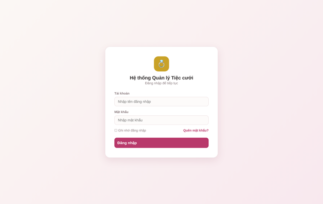
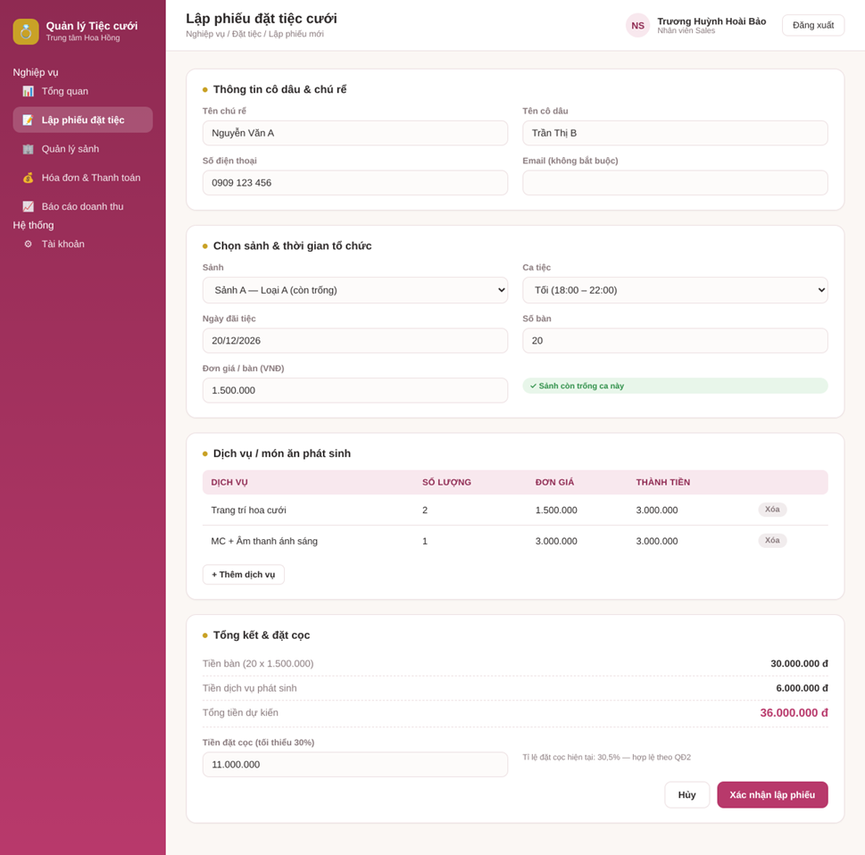
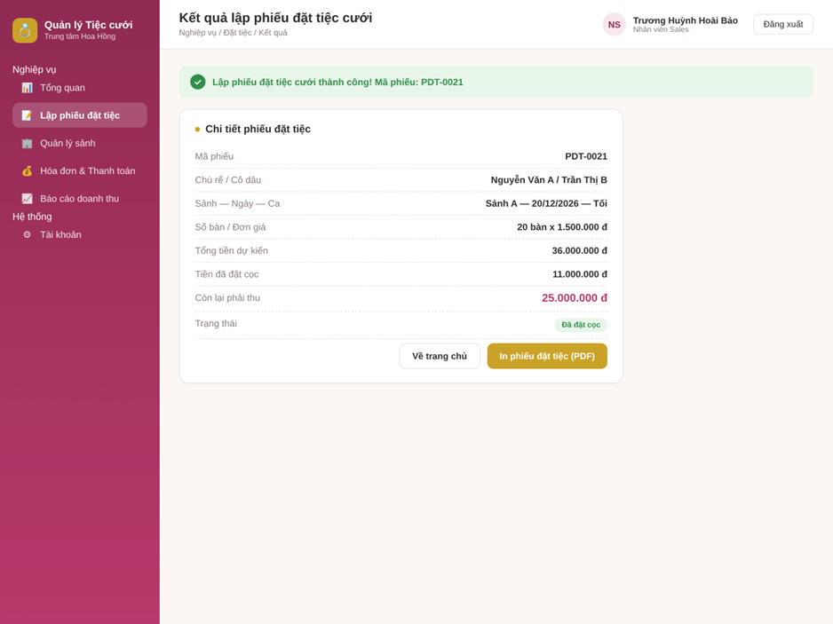
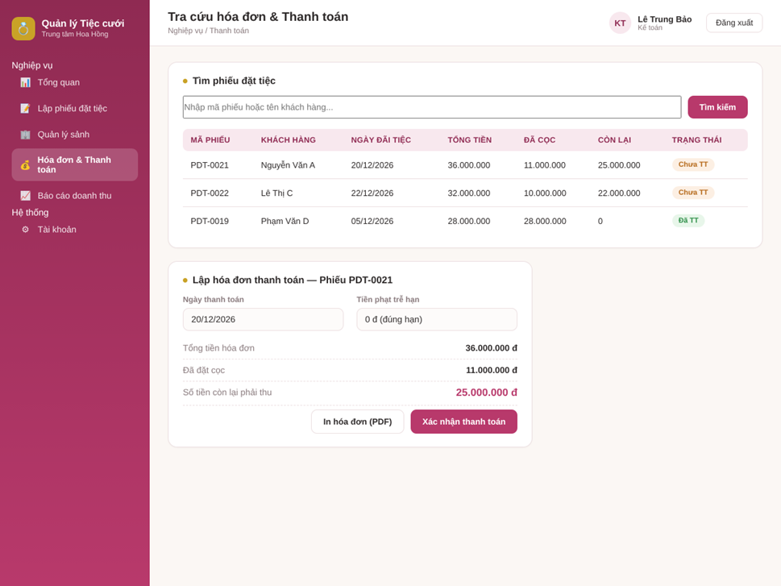
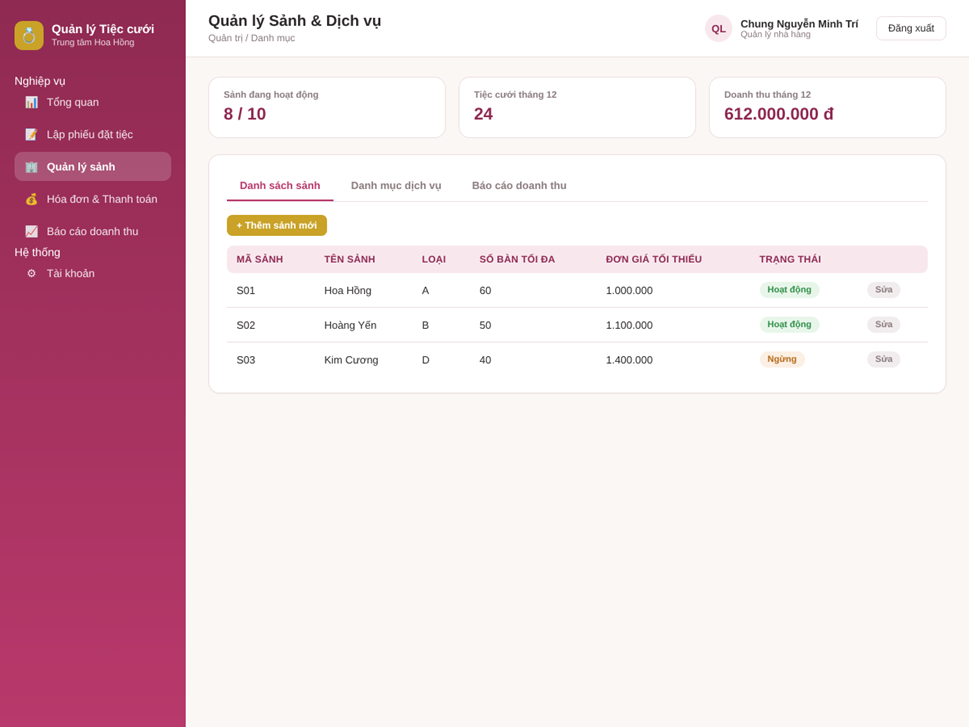

# Thiết kế giao diện — Hệ thống Quản lý Tiệc cưới

> Trích từ Báo cáo Lab 6 (Tuần 6: Architectural & Detailed Design), Chương 4.
> Nguồn: `Lab6_NhomBTB_52400170.docx`
>
> Các màn hình dưới đây được dựng ở mức high-fidelity mock-up trong báo cáo Lab 6.

## 1. Danh sách màn hình và vai trò

| Màn hình                     | Vai trò sử dụng   | Mục đích                                              |
| ---------------------------- | ----------------- | ----------------------------------------------------- |
| Đăng nhập                    | Tất cả người dùng | Xác thực tài khoản, điều hướng theo vai trò           |
| Lập phiếu đặt tiệc cưới      | Nhân viên Sales   | Nhập thông tin đặt tiệc, chọn sảnh, dịch vụ, đặt cọc  |
| Kết quả lập phiếu            | Nhân viên Sales   | Hiển thị thông tin phiếu vừa lập, cho phép in PDF     |
| Tra cứu hóa đơn & thanh toán | Kế toán           | Tìm phiếu, lập hóa đơn, ghi nhận thanh toán           |
| Quản lý sảnh & dịch vụ       | Quản lý nhà hàng  | Quản lý danh mục sảnh, dịch vụ, xem báo cáo doanh thu |

## 2. Màn hình Đăng nhập

- **Người dùng:** tất cả (Khách hàng, Sales, Kế toán, Quản lý, Admin).
- **Dữ liệu nhập:** Tài khoản, Mật khẩu.
- **Nút chức năng:** [Đăng nhập], liên kết "Quên mật khẩu?".
- **Phản hồi thành công:** chuyển đến màn hình chính theo vai trò.
- **Phản hồi thất bại:** thông báo "Sai tài khoản hoặc mật khẩu", không tiết lộ tài khoản nào sai.

## 3. Màn hình Lập phiếu đặt tiệc cưới

- **Người dùng:** Nhân viên Sales.
- **Dữ liệu nhập:** tên chú rể/cô dâu, SĐT, sảnh, ngày đãi tiệc, ca, số bàn, đơn giá, danh sách dịch vụ, tiền đặt cọc.
- **Nút chức năng:** [+ Thêm dịch vụ], [Hủy], [Xác nhận lập phiếu].
- **Phản hồi thành công:** chuyển sang màn hình Kết quả lập phiếu (mục 4).
- **Phản hồi lỗi:** hiển thị ngay tại trường bị lỗi, ví dụ:
  - "Sảnh đã có người đặt trong ca này"
  - "Đơn giá thấp hơn mức tối thiểu của loại sảnh"
  - "Tiền cọc chưa đạt tỉ lệ tối thiểu 30%"

## 4. Màn hình Kết quả lập phiếu

- **Người dùng:** Nhân viên Sales.
- **Dữ liệu hiển thị:** mã phiếu, thông tin tiệc cưới, tổng tiền dự kiến, tiền cọc, số tiền còn lại, trạng thái.
- **Nút chức năng:** [In phiếu đặt tiệc (PDF)], [Về trang chủ].

## 5. Màn hình Tra cứu hóa đơn và Thanh toán

- **Người dùng:** Kế toán.
- **Dữ liệu nhập:** từ khóa tìm kiếm (mã phiếu/tên khách hàng), ngày thanh toán.
- **Nút chức năng:** [Tìm], [Xác nhận thanh toán], [In hóa đơn (PDF)].
- **Phản hồi:** hệ thống tự tính tiền phạt trễ hạn (nếu có) và số tiền còn lại ngay khi nhập ngày thanh toán; sau khi xác nhận, trạng thái phiếu chuyển thành "Đã thanh toán".

## 6. Màn hình Quản lý Sảnh & Dịch vụ

- **Người dùng:** Quản lý nhà hàng.
- **Dữ liệu nhập:** tên sảnh, loại sảnh, số bàn tối đa, đơn giá tối thiểu (khi thêm/sửa sảnh).
- **Nút chức năng:** [+ Thêm sảnh mới], [Sửa] theo từng dòng, [Xem báo cáo] theo tháng chọn.
- **Phản hồi lỗi khi thêm sảnh:** "Mã/tên sảnh đã tồn tại" hoặc "Đơn giá thấp hơn mức tối thiểu theo loại sảnh".

## 7. Ánh xạ sang mã nguồn (Lab 7)

| Màn hình (Lab 6)              | Trang Frontend                                          |
| ----------------------------- | ------------------------------------------------------- |
| Đăng nhập                     | `frontend/src/pages/Login.jsx`                          |
| Tổng quan (menu theo vai trò) | `frontend/src/pages/Home.jsx` + `components/Layout.jsx` |
| Lập phiếu đặt tiệc cưới       | `frontend/src/pages/Booking.jsx`                        |
| Kết quả lập phiếu             | `frontend/src/pages/BookingResult.jsx`                  |
| Tra cứu hóa đơn & thanh toán  | `frontend/src/pages/Payment.jsx`                        |
| Quản lý sảnh & dịch vụ        | `frontend/src/pages/HallManagement.jsx`                 |
